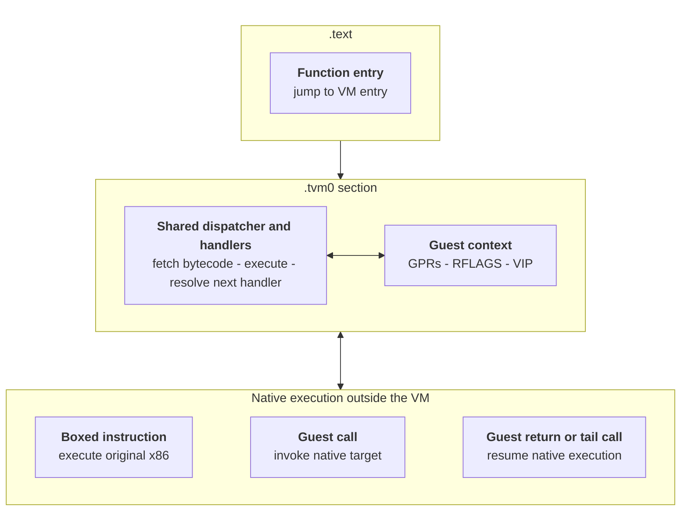

# tvm-devirt

A static devirtualizer targeting Tencent VM (TVM). Recovers virtualized control flow & attempts to lower guest behavior back to native x86.

This fork integrates the recovery, diagnostics, native tail-call emission and
incremental PE writeback used during the v9 recovery work. See
[v9 integration and usage (中文)](docs/v9-integration.md) for the included changes,
Windows build instructions, validation scope and remaining limitations.

Devirtualized DriverEntry of ACE-GAME.sys.


## Build

```bash
cargo build --release
cargo test
```

## Usage

List virtualized entry points:

```bash
tvm-devirt entries input.exe --all
```

Inspect one function:

```bash
tvm-devirt cfg input.exe 0x140001000
tvm-devirt ssa input.exe 0x140001000
tvm-devirt lower input.exe 0x140001000
tvm-devirt devirt input.exe 0x140001000 --output function.bin
```

Devirtualize all recoverable functions, appending code to the last PE section
and marking that section executable:

```bash
tvm-devirt write-devirt input.exe output.exe
```

Batch recovery defaults to `min(available logical cores, 8)` workers. Use
`--cpu-percent 60` to choose `floor(available logical cores * 60 / 100)` workers
(at least one, up to the available core count); for example, 20 logical cores
selects 12 workers. This is a concurrency budget, not a hard CPU utilization
limit: actual usage depends on the functions being recovered and other work on
the machine. More workers also require more memory. Use `--jobs N` for an
explicit worker count; it is mutually exclusive with `--cpu-percent`.

```bash
tvm-devirt write-devirt input.dll output.dll --cpu-percent 60
```

Diagnose an incomplete function or extend a previous output while still analyzing
the original input:

```bash
tvm-devirt unresolved input.dll 0x180001000 --json unresolved.json
tvm-devirt write-devirt input.dll next.dll --patch-base previous.dll --only-entry 0x180001000 --max-blocks 1024
```

`--timeout` is a wall-clock backstop for each exploration pass. A function may
need several passes, and the explorer checks time between recovered blocks.
The total time shown for a function can therefore exceed `--timeout`. For a
retry of timed-out entries, pass a larger value explicitly, for example
`--timeout 1800`; the default remains 600 seconds. A larger timeout does not
resolve missing control-flow edges or values without a proven definition.

Run `tvm-devirt --help` or `tvm-devirt <command> --help` for all options.

## TVM Overview

TVM replaces a native function with a trampoline into a VM dispatcher. The dispatcher executes native x86 handlers, but the protected function's architectural state lives in the VM context.



Some operations execute outside the VM. A **boxed instruction** runs its original x86 encoding after the VM restores the registers it needs, then returns its effects to the guest context. A **guest call** invokes a native target and resumes with the return value and Windows x64 ABI clobbers represented in guest state. Guest returns and tail calls leave the dispatcher entirely.

The context contains all sixteen guest general-purpose registers, including the guest `RSP`, plus packed guest flags. The exact context layout can vary. The default locator uses observed entry spills and register-content scoring over supported layouts; duplicated register images can make this heuristic ambiguous.

Conditional control flow is implemented through dispatch arithmetic. A handler extracts a guest flag or predicate, uses it to select the next virtual program counter, and computes the address of the next native handler. The devirtualizer symbolically evaluates that process and forks the evaluator when the selected path depends on an unresolved guest value.

## Project Layout

```text
src/binary/   PE parsing, disassembly, format constants
src/vm/       VM entry discovery, state, and CFG exploration
src/ir/       symbolic expressions, hashing, lifting, scheduling, and allocation
src/codegen/  x86 emission, control flow, operands, frame layout, and unwind data
src/cli/      inspection, recovery, formatting, and writeback commands
```

## Limitations

- Codegen quality is far from perfect and the output binaries are meant for analysis only.
- Unsupported or unresolved VM behavior can leave a function incomplete.
- Emitted Windows unwind data describes the new stack frame. Original exception
  handlers, cleanup state and PC scope tables are not translated to the new code
  addresses; preserving the old `.pdata` records does not provide this coverage.
- Recovery counts, PE structure checks and stack-unwind tests do not establish
  behavioral equivalence. Validate generated instructions against the original
  paths, including values preserved across calls and block boundaries.
- Generated-body stack checks do not cover retained `.tvm0` code. IDA may still
  report positive SP values when interpreting VM stack switches or dispatch
  CALLs as ordinary C functions; inspect the failing address and original bytes.
- `TVM_DIAGNOSTIC_CONTEXT_ORIGIN=1` enables an experimental storage-origin
  tracker, disabled by default. A complete restore/save round trip does not
  prove which mirror subsequent VM instructions consume. This mode prints a
  diagnostic notice and permits `write-devirt` only with one `--only-entry`;
  its outputs are experiments, excluded from verified recovery counts.
- `TVM_DIAGNOSTIC_LOCATION_HOMES=1` is a separate experiment for proving exact
  private storage locations against register homes on every incoming edge.
  It is disabled by default and mutually exclusive with context-origin mode.
  Diagnostic writeback requires one `--only-entry`. Passing a scoped comparison
  does not promote an experimental output to verified recovery.

## Credits

- [NeuroSaki987/tvm-devirt-mirror](https://github.com/NeuroSaki987/tvm-devirt-mirror) for the integrated recovery diagnostics.
- [k0mkc](https://k0mkc.hatenablog.com/archive/category/AntiCheatExpert)
- [Back Engineering Labs](https://back.engineering/blog/31/07/2026/)
